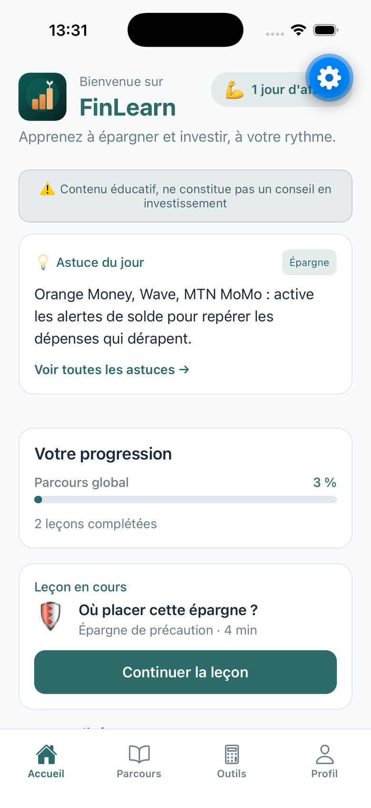
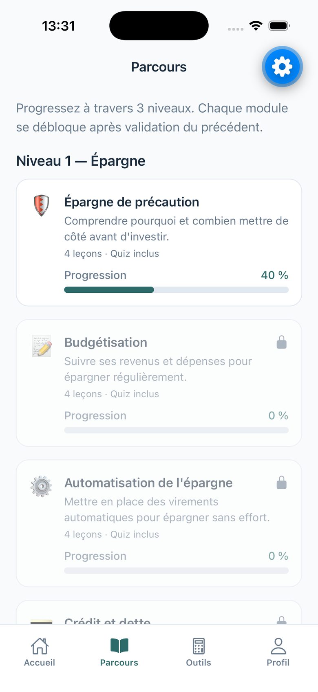
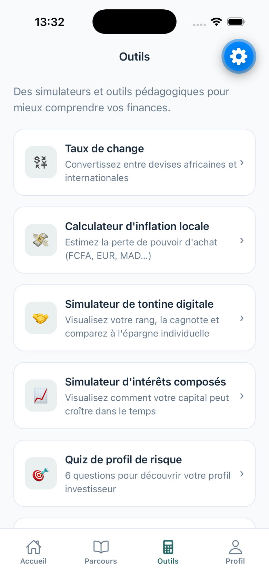
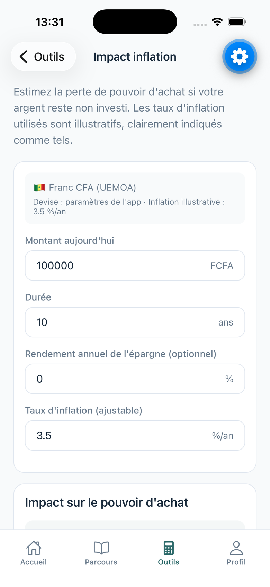

# FinLearn

**Éducation financière pour la francophonie et l’Afrique de l’Ouest et centrale.**

De « je ne sais pas épargner » à « je comprends pourquoi je choisis cet ETF » — un parcours progressif, des simulateurs ancrés dans les réalités locales (mobile money, tontines, FCFA), sans importer des produits occidentaux inadaptés.

Contenu **100 % éducatif**. FinLearn ne fournit aucun conseil en investissement personnalisé.

[](https://expo.dev)
[](https://reactnative.dev)
[](https://www.typescriptlang.org)
[](LICENSE)

<p align="center">
  
  &nbsp;
  
  &nbsp;
  
  &nbsp;
  
</p>

Site public : [eliott243.github.io/finlearn](https://eliott243.github.io/finlearn/)
· [Confidentialité](https://eliott243.github.io/finlearn/privacy.html)
· [Conditions](https://eliott243.github.io/finlearn/terms.html)

## Fonctionnalités

- **Parcours en 3 niveaux** : épargne de précaution → budget → investissement / supports
- **Leçons courtes** + quiz de validation ; les modules se débloquent progressivement
- **Simulateurs** : tontine digitale, intérêts composés, inflation locale (FCFA, EUR, MAD…)
- **Taux de change** entre devises africaines et internationales
- **Fiches ETF** et quiz de profil de risque, clairement indiqués comme éducatifs
- **Astuce du jour**, streak, avatars débloqués, certificats
- **Fil d’actualité** financière africaine
- **Hors ligne** (offline-first, AsyncStorage)
- **Notifications** optionnelles (astuce du matin)

## Stack

| Couche | Choix |
| --- | --- |
| App | Expo 57, React Native, TypeScript |
| Navigation | React Navigation (tabs + stacks) |
| UI | NativeWind / StyleSheet, thème `#2D6A6A` |
| Données | AsyncStorage, contenu pédagogique local |
| Actu / FX | RSS + cache, Open ER API |
| Store | Android `com.finlearn.app` (AAB via EAS) |
| Site légal | GitHub Pages (`docs/`) |

## Lancer en local

```bash
git clone https://github.com/Eliott243/finlearn.git
cd finlearn
npm install
npx expo start
```

Ensuite :
- `i` — iOS Simulator
- `a` — Android emulator
- scanne le QR avec Expo Go

```bash
npm run ios          # iOS, cache Metro vidé
npx expo start --web # aperçu web
```

## Build Play Store

Package Android : `com.finlearn.app`

```bash
npx eas-cli login
npx eas-cli build -p android --profile production
```

Les profils EAS sont dans [`eas.json`](eas.json).

## Structure

```
app/
  screens/        accueil, parcours, outils, profil, simulateurs
  navigation/     tabs et stacks
  data/           leçons, ETF, tontines, tips
  services/       actualités, taux de change
  context/        progression, avatars
docs/             site public + politique / CGU + captures
assets/           icône, splash, badges
```

## Licence

MIT — voir [LICENSE](LICENSE).
